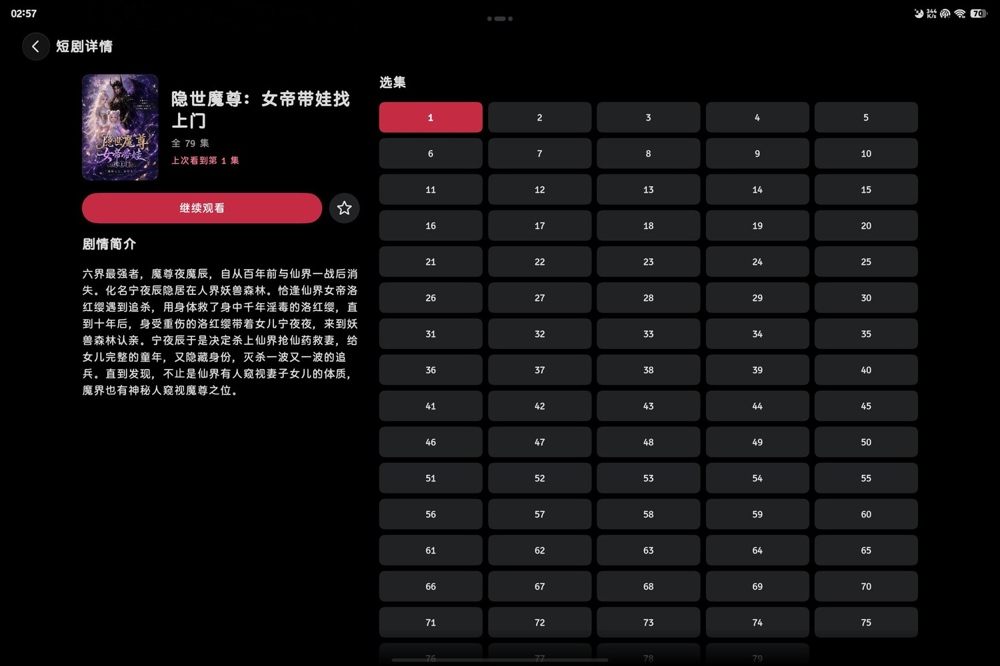

# 红果短剧 · HarmonyOS

面向手机、平板和鸿蒙电脑的红果短剧原生适配，最低兼容 HarmonyOS 6.1.0（API 23）。应用内集成红果 Go 核心，可在设备上独立运行。

本发布仓库 fork 自 [aston314/hongguo-tv-releases](https://github.com/aston314/hongguo-tv-releases)。鸿蒙版的 Go 核心基于 [aston314/hongguo-tv 的 5414d05 提交](https://github.com/aston314/hongguo-tv/commit/5414d056b4f81b54c5f40dddbf46181d8cb62bf0)。Android TV、webOS 和桌面版继续由 [上游发布页](https://github.com/aston314/hongguo-tv-releases/releases) 提供。

## 界面截图

| 平板 · 推荐首页 | 手机 · 推荐首页 |
| --- | --- |
|  |  |

| 平板 · 短剧详情 | 平板 · 播放与选集 |
| --- | --- |
|  |  |

## 鸿蒙版功能

- 推荐书架、分类与搜索，浮动页签和深浅色适配。
- 系统画中画、最高 3× 播放、下一集预加载、鸿蒙跨设备接续。
- 播放侧栏选集与评论，观看历史、收藏、扫码登录和预约。

## HAP 与安装

鸿蒙构建包含 arm64-v8a 和 x86_64。无签名 HAP 用于后续签名和调试，需在 DevEco Studio 配置设备调试签名后安装。

## 来源与版权

- 上游原项目及 Go 核心的著作权归 **aston314 及相关贡献者**。上游源码仓库当前未附通用分发许可证。 [hongguo-tv](https://github.com/aston314/hongguo-tv)
- 部分 HDS 导航和播放器界面改编自 **crazypig321 的 FQHouseOH 1.1.3**，沿用 GPL-3.0 声明。 [FQHouseOH 源码](https://github.com/crazypig321/FQHouseOH/tree/68cc833b46292264761c09d88fcfe335b8078246) · [GPL-3.0 许可证](https://github.com/crazypig321/FQHouseOH/blob/68cc833b46292264761c09d88fcfe335b8078246/LICENSE)
- 设置图标来自 OpenHarmony `applications_settings`，遵循 Apache-2.0。 [OpenHarmony 设置应用源码](https://gitcode.com/openharmony/applications_settings)
- 红果短剧名称、标识及截图中的封面和剧照归各自权利人。截图用于展示鸿蒙版界面。
